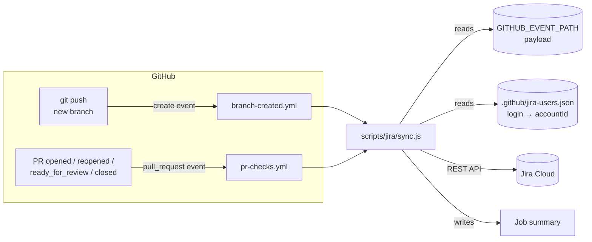

# demo-github-pull-request-jira-sync

An example GitHub Actions pipeline that keeps Jira work items in step with the branches and pull requests doing the work, so nobody has to drag cards across the board.

- Push a branch named `dev-123-…` → **DEV-123** moves to _In Progress_, is assigned to you, and joins the active sprint.
- Open the pull request → the author is assigned and the item is put in the active sprint (in case the branch was created before the sprint started).
- Merge a PR whose description says `Closes DEV-123` → **DEV-123** moves to _QA Ready_.
- Close a PR without merging → the item goes back to _In Progress_.

One Node script with no dependencies ([`scripts/jira/sync.js`](scripts/jira/sync.js)) does all of it, called from two small workflows. It never fails a build: anything it can't do is written to the job summary and the run still passes.

---

## Strategy

### 1. The branch name says which item the work is for

The work item key goes at the **front of the branch name**, and that is the only place the pipeline reads a PR's _own_ item from:

```
dev-288-ci-jira-automation   →  DEV-288
```

The other places don't work for this:

| Place          | Why it isn't used for the PR's own item                                                   |
| -------------- | ----------------------------------------------------------------------------------------- |
| PR title       | Conventional-commit subject (`feat: …`) that becomes the squash commit on `main`. No key. |
| PR description | Free text that often mentions _other_ tickets ("follow-up to DEV-275").                   |
| Commits        | Many per PR, written before the PR exists, and easy to get wrong.                         |

Lowercase keys in branch names are fine. Jira's GitHub app matches them either way, and the script uppercases before calling the REST API.

### 2. Work starts at the branch, not the PR

A PR often shows up days after the branch. If the board only reacts to PRs, the item sits in _To Do_, unassigned, and looks like nobody has picked it up. So the **`create`** event (a branch being pushed) is what moves the item to _In Progress_.

### 3. Only an explicit "Closes" moves an item to done

Jira attaches a PR to every item whose key appears **anywhere** in it, description included. Closing "every linked item when the PR merges" would close tickets from PRs that only mentioned them. So:

- The item moves on merge **only** when the PR description says `Closes`/`Fixes`/`Resolves` followed by the key.
- `Related to DEV-456` links the PR in Jira and changes nothing.
- A key inside `` `code` `` or a fenced block is ignored. That way a PR documenting the convention ("write `Closes DEV-123`") doesn't close DEV-123.
- One PR can close several items: `Closes DEV-1, DEV-2`. Each key is handled on its own, so one missing key doesn't skip the rest.

### 4. Never move delivered work backwards

If an item is already _QA Ready_, _QA Passed_, _Release Ready_, or in any Jira status in the **done** category, neither of these moves it back to _In Progress_:

- a follow-up branch cut from it (`dev-123-fix-typo`)
- a second PR closed without merging after another PR already delivered it

### 5. Jira problems never block a merge

Missing credentials, an unmapped GitHub user, no active sprint, a key that doesn't exist, or a Jira outage all show up as a ⚠️ line in the job summary. The run still **exits 0**. The Jira sync is a convenience and must not gate delivery.

### 6. Guard the branch name early

The key is only read from the branch name, so a wrong name means the sync can't find the item. Branch names are checked twice, against **one** pattern stored in `package.json`:

1. **Locally**, by a Husky `pre-push` hook, before Jira ever sees the branch.
2. **In CI**, by the `Branch name` step in `pr-checks.yml`, which catches branches created in the GitHub web UI or on a machine without the hook.

PRs with no work item use a no-ticket prefix (`chore-`, `ci-`, `docs-`, `test-`, `refactor-`, `deps-`, `spike-`) or the `no-ticket` label.

---

## How it fits together



Both workflows call the same script. It works out which event it's handling from the payload (`pull_request` present, or `ref_type == 'branch'`), so the workflows differ only in their trigger.

### Event → Jira action

| GitHub event                                              | Item it acts on                                                | Jira changes                                                                                          |
| --------------------------------------------------------- | -------------------------------------------------------------- | ----------------------------------------------------------------------------------------------------- |
| `create` (branch)                                         | Key from the branch name                                       | Transition to _In Progress_ (unless already delivered) · assign the pusher · add to the active sprint |
| `pull_request` `opened` / `reopened` / `ready_for_review` | Key from the head branch                                       | Assign the PR author · add to the active sprint                                                       |
| `pull_request` `closed`, merged                           | Every key after `Closes`/`Fixes`/`Resolves` in the description | Transition to _QA Ready_                                                                              |
| `pull_request` `closed`, not merged                       | Key from the head branch                                       | Transition back to _In Progress_ (unless already delivered)                                           |
| `create` (tag), branch with no key                        | none                                                           | Nothing; the reason is noted in the summary                                                           |

### Jira REST calls used

| Purpose                                     | Endpoint                                                                                           |
| ------------------------------------------- | -------------------------------------------------------------------------------------------------- |
| Read current status                         | `GET /rest/api/3/issue/{key}?fields=status`                                                        |
| Find and apply a transition                 | `GET`/`POST /rest/api/3/issue/{key}/transitions`                                                   |
| Assign                                      | `PUT /rest/api/3/issue/{key}/assignee`                                                             |
| Find the Sprint field id (differs per site) | `GET /rest/api/3/field`                                                                            |
| Find the scrum board and its active sprint  | `GET /rest/agile/1.0/board?projectKeyOrId=…`, `GET /rest/agile/1.0/board/{id}/sprint?state=active` |
| Add to sprint                               | `POST /rest/agile/1.0/sprint/{id}/issue`                                                           |

Transitions are looked up **by target status name**, not hard-coded ids, so the script keeps working when the Jira workflow is edited. If the item already has the target status, the script does nothing, so there are no empty entries in the item's history.

---

## Repository layout

```
.github/
  workflows/
    branch-created.yml     # on: create        → sync.js
    pr-checks.yml          # on: pull_request  → tests, branch name, PR title, sync.js
  jira-users.json          # GitHub login → Jira accountId
  pull_request_template.md # pre-fills "Closes DEV-" and explains the rules
.husky/pre-push            # validates the branch name before it reaches GitHub
scripts/jira/
  sync.js                  # event handling + Jira REST calls
  parse.js                 # pure key parsing (branch name, "Closes" lines)
  parse.test.js            # node --test
package.json               # branch-name pattern, test script
```

---

## Setup

### 1. Jira API token

Create a token for the account the automation will act as (a dedicated service account keeps the history readable) at <https://id.atlassian.com/manage-profile/security/api-tokens>. That account needs permission to browse, transition, and assign issues and to manage sprints in the project.

### 2. Repository secrets and variables

**Settings → Secrets and variables → Actions**

| Kind     | Name                      | Example                            | Required              |
| -------- | ------------------------- | ---------------------------------- | --------------------- |
| Secret   | `JIRA_USER_EMAIL`         | `automation@example.com`           | yes                   |
| Secret   | `JIRA_API_TOKEN`          | _(the token)_                      | yes                   |
| Variable | `JIRA_BASE_URL`           | `https://your-site.atlassian.net`  | yes                   |
| Variable | `JIRA_PROJECT_KEY`        | `DEV`                              | no, defaults to `DEV` |
| Variable | `JIRA_STARTED_STATUS`     | `In Progress`                      | no                    |
| Variable | `JIRA_MERGED_STATUS`      | `QA Ready`                         | no                    |
| Variable | `JIRA_DELIVERED_STATUSES` | `QA Ready,QA Passed,Release Ready` | no                    |

The status names must match your Jira workflow exactly. Until the three required values are set, every run logs "credentials are not configured" and passes.

```sh
gh secret set JIRA_USER_EMAIL
gh secret set JIRA_API_TOKEN
gh variable set JIRA_BASE_URL --body "https://your-site.atlassian.net"
gh variable set JIRA_PROJECT_KEY --body "DEV"
```

### 3. Map GitHub users to Jira accounts

Add each contributor to [`.github/jira-users.json`](.github/jira-users.json):

```json
{ "octocat": "712020:aaaaaaaa-bbbb-cccc-dddd-eeeeeeeeeeee" }
```

The map is keyed by **GitHub login**, not email. A person's commits carry whatever email their git config had at the time, but the login is one stable value in every webhook. To find an `accountId`, open the person's Jira profile (it's the id in the URL) or call `GET /rest/api/3/user/search?query=<email>`. An unmapped login leaves the item unassigned and says so in the summary.

### 4. Install the Jira GitHub app

[GitHub for Jira](https://marketplace.atlassian.com/apps/1219592/github-for-jira) is what shows branches, PRs, and commits on the Jira item. This pipeline handles status, assignee, and sprint. The app handles the links.

### 5. Local hook and label

```sh
npm install                       # installs husky + validate-branch-name, sets up the pre-push hook
gh label create no-ticket --description "PR has no Jira work item"
```

---

## Day-to-day usage

```sh
git switch -c dev-123-add-notifications
git push -u origin HEAD           # DEV-123 → In Progress, assigned, in sprint

gh pr create --title "feat: add notifications"
# description (from the template):
#   Closes DEV-123

# merge → DEV-123 → QA Ready
```

Each run's results appear in the workflow run's **Summary** tab under **Jira**, for example:

```
### Jira

DEV-123 → In Progress
DEV-123 assigned to octocat
DEV-123 added to sprint "Sprint 34"
```

---

## Notes and gotchas

- **Workflow files run from the new branch.** For `create` events, GitHub reads `branch-created.yml` from the branch that was just pushed, which is a copy of `main` at the time it was cut. Changes to that workflow only apply to branches created after the change merges.
- **Fork PRs are skipped.** Their workflow runs get no secrets, so `pr-checks.yml` only runs for branches in this repository.
- **Untrusted input stays out of the shell.** The PR title and branch name go into `run:` steps as environment variables, never as `${{ }}` inside the script, so backticks or `$( )` in a title can't be executed.
- **Exactly one active sprint is required.** With none, or with parallel sprints on the board, the sprint is left unset and the summary says why.
- **Uppercase keys in the PR description.** Jira's GitHub app matches a lowercase key in a branch name but only links an uppercase key in a PR description. The script accepts either for `Closes`, but write it in uppercase so the link appears in Jira too.

## Tests

```sh
npm test
```

They cover the parsing rules: reading the key from a branch name, reading `Closes` lines, and ignoring keys inside code. The Jira calls are thin wrappers around the REST endpoints listed above. To try them end to end, set the secrets on a fork and push a `dev-N-…` branch.
